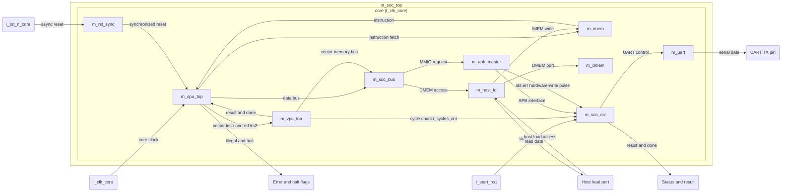
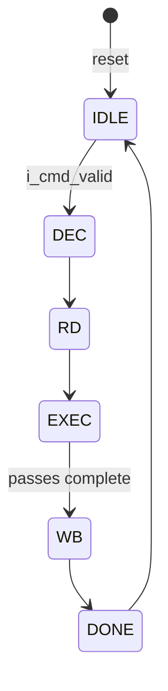
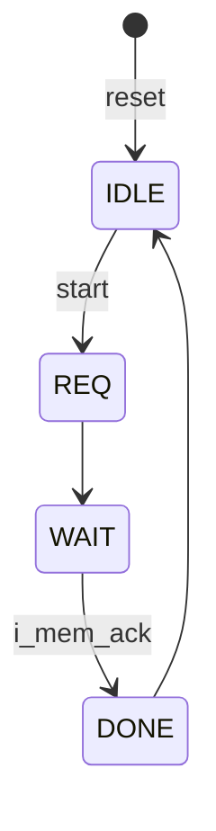

# RISC-V + VPU MNIST Inference System (rv32_vpu_mnist) — Block Specification

Top module: `m_soc_top`

<!-- section: purpose_scope -->
## 1. Purpose, Scope, and Product Context

| | |
|---|---|
| **IP name** | m_soc_top (rv32_vpu_mnist: RV32I+Zmmul 5-stage core with in-house Zve32x VPU) |
| **Version** | 0.3 |
| **Status** | Draft |

### 1.1 Purpose and scope

This IP is a small system that takes one handwritten MNIST digit (28x28, INT8) and outputs the predicted label 0-9. A pre-trained INT8 MLP (784→128 ReLU →10) is executed by firmware on an in-house scalar RISC-V core. The core offloads the dot product, bias add, requantize and ReLU to an in-house vector unit (VPU, subset of RVV 1.0 Zve32x). The scalar core performs the final 10-element argmax. Users are the RTL, firmware and verification teams.

Included:
- `m_soc_top` containing `m_cpu_top` (RV32I+Zmmul, 5 stages), `m_vpu_top` (VLEN=128, 4 lanes), `m_imem`, `m_dmem`, `m_soc_bus`, `m_apb_master`, `m_soc_csr` (tool-generated APB4 slave), `m_uart`, `m_rst_sync`, `m_host_ld`.
- A host load port (`i_ld_*`, `o_ld_rd_data`) for IMEM/DMEM access while the core is in reset.
- Firmware, quantized weights, bit-exact golden model, and test suite (deliverables outside the RTL).

Excluded:
- Training in hardware, camera/image preprocessing, batch > 1, CNN/convolution.
- ASIC/PPA work, DFT, UPF (deferred, see section 16 and 20).
- Vector masking, gather/scatter, strided loads, floating point, chaining, exceptions, interrupts.
- The PCIe wrapper that drives the host load port on the FPGA.
- The UART bootloader (extension).
- Detailed bit-level ISA documentation (option B).

### 1.2 Deployment assumptions

| Item | Assumption |
|---|---|
| Target SoC / product class | Standalone FPGA prototype (Catapult v3, Intel Arria 10 1150, part number to be reconfirmed) |
| Technology / library | FPGA M20K inferred memories inside `m_imem`/`m_dmem`; DSP blocks for multipliers; target 200 MHz (not hard) |
| Operating modes / workload | One image at a time; ~50-100k cycles per inference (estimate) |
| Security / privilege | None; single privilege level |
| External dependencies | Host (optional, via PCIe wrapper) driving `i_ld_*`; external start pin `i_start_req`; UART terminal; firmware image; clock and reset source |

*Table 1-1: Deployment context of the IP; read each row as an assumption the integrator must satisfy.*

### 1.3 Feature summary

| Feature ID | Feature | Required / optional | Configuration condition | Requirement ids |
|---|---|---|---|---|
| FEAT-001 | RV32I+Zmmul 5-stage scalar core, `mul`, no `div/rem` | Required | All | REQ-FUNC-001, REQ-FUNC-002, REQ-FUNC-003 |
| FEAT-002 | Illegal-instruction halt with `o_err_illegal` | Required | All | REQ-ERR-001 |
| FEAT-003 | VPU executing the Zve32x subset of table 4.1 of the intent | Required | All | REQ-FUNC-004, REQ-FUNC-005, REQ-FUNC-006, REQ-FUNC-007, REQ-FUNC-008 |
| FEAT-004 | Scalar-VPU dispatch with full-pipeline stall | Required | All | REQ-FUNC-009 |
| FEAT-005 | Instruction memory 32 KB, data memory 256 KB | Required | All | REQ-FUNC-010, REQ-FUNC-011 |
| FEAT-006 | APB4 MMIO to tool-generated CSR block | Required | All | REQ-IF-001, REQ-IF-002, REQ-IF-003 |
| FEAT-007 | UART transmit of the result digit | Required | All | REQ-FUNC-012 |
| FEAT-008 | Host load port for IMEM/DMEM | Required | All (tie off when unused) | REQ-IF-004 to REQ-IF-009 |
| FEAT-009 | Cycle counter `cycles` | Required | All | REQ-FUNC-013 |
| FEAT-010 | Parameterized VLEN / lane count | Optional | PARA_VLEN, PARA_LANE_COUNT | REQ-PARAM-001, REQ-PARAM-002 |
| FEAT-011 | Reset synchronization | Required | All | REQ-RESET-001 |

*Table 1-2: Externally observable features and the requirements that elaborate them.*

<!-- section: references -->
## 2. Normative References and Precedence

### 2.1 Normative references

| Ref ID | Document and revision | Applicable clauses | Authority / notes |
|---|---|---|---|
| REF-001 | RISC-V Unprivileged ISA, RV32I and Zmmul (ratified, as in GCC 14.2 `-march=rv32i_zmmul_zve32x`) | Base integer, Zmmul | Scalar behavior |
| REF-002 | RISC-V Vector Extension 1.0, profile Zve32x | Instructions in section 3 | VPU behavior; subset only |
| REF-003 | VLSIT RTL Design Rules v2 (`VLSIT_RTL_Design_Rule.md`) | All | Mandatory RTL coding, hierarchy, reset, naming baseline |
| REF-004 | IEEE 1800-2017 | Synthesizable subset, subject to REF-003 | Language |
| REF-005 | VLSIT CSR Specification workbook `csr/rv32_vpu_mnist_csr.xlsx` | Whole workbook | Sole authority for the register interface |
| REF-006 | AMBA APB Protocol Specification, APB4 (IHI 0024C) | Completer-side and requester-side signals incl. PSTRB, PPROT, PSLVERR | `m_apb_master` and `m_soc_csr` |
| REF-007 | APB-CSR-Generator (`APB-CSR-Generator`, README) | Generated module behavior | Behavior of `m_soc_csr` |

*Table 2-1: Normative references. REF-005 is the only place registers are defined.*

### 2.2 Source-of-truth and conflict handling

1. APB4 (REF-006) defines APB protocol behavior; RVV 1.0 / RISC-V ISA define instruction behavior; the approved intent defines product behavior.
2. This spec shall stay consistent with the protocol and REF-003. A requirement that conflicts with REF-003 is revised, never made an RTL exception. The single known exception is the tool-generated `m_soc_csr` (see ASM-006).
3. Registers are specified only in REF-005. Section 11 does not restate them.
4. Protocol revision: APB4 with PSTRB and PSLVERR; PPROT is present but not checked (`i_protect_en` = 0).
5. Conflicts are resolved by an explicit product decision, never guessed.

### 2.3 Compliance declaration

| Standard | Revision / profile | Role implemented | Options | Deviations |
|---|---|---|---|---|
| RISC-V scalar | RV32I + Zmmul | Core | No `div/rem`, no interrupts/exceptions, no M-mode CSRs; illegal instruction halts | No `mstatus`; custom `m_csr_min` cycle counter |
| RVV 1.0 | Zve32x, VLEN=128, ELEN=32, LMUL=1 required (2, 4 optional) | Executor | Instruction subset of section 3; no masking | Unit-stride loads aligned to 16 bytes |
| APB4 | IHI 0024C | Requester (`m_apb_master`); completer (`m_soc_csr`) | Full 4-byte strobes only | `m_soc_csr` port names do not follow PRT-01 (ASM-006) |

*Table 2-2: Standards compliance and deviations.*

<!-- section: requirements -->
## 3. Requirements and Traceability

| ID | Requirement | Source | Applies to | Verification |
|---|---|---|---|---|
| REQ-FUNC-001 | The core shall implement RV32I base instructions (arithmetic/logic, `lui`, `auipc`, jumps, branches, `lb lh lw lbu lhu sb sh sw`) with a 5-stage in-order pipeline (IF, ID, EX, MEM, WB) at one instruction per cycle absent hazards. Misaligned loads and stores shall not trap: byte enables and data are shifted by `addr[1:0]` and bytes falling outside the word are dropped, with no word-crossing split. A misaligned load returns `word >> (8 x addr[1:0])` with the missing upper bytes zero-filled, then the normal sign or zero extension of the access width is applied. | Intent 5.1, 5.3 | All | Simulation |
| REQ-FUNC-002 | The core shall implement `mul` (Zmmul) returning the low 32 bits of the signed product and shall treat `div`, `divu`, `rem`, `remu` and `mulh*` as illegal instructions. | Intent 5.1 | All | Simulation |
| REQ-FUNC-003 | The core shall resolve branches and jumps in EX, predict not-taken, and flush IF/ID when taken; it shall forward EX/MEM→EX and MEM/WB→EX, and insert exactly 1 bubble for a load followed by an immediate use. `m_regfile` shall bypass a same-cycle WB write to a read port (write-to-read bypass), with `x0` still reading 0. A wrong-path instruction flushed by a taken branch or jump before it commits has no effect: an illegal instruction or `ebreak` in that shadow shall not halt the core and shall not set `o_err_illegal` or `sts.err`. | Intent 5.3 | All | Simulation, assertion |
| REQ-FUNC-004 | The VPU shall execute `vsetvli`, `vsetivli` (including `vsetvli zero,zero,...`) with `vl = min(AVL, VLMAX)`, `VLMAX = (PARA_VLEN/SEW) x LMUL`, and return `vl` through `o_resp_rd_data`. For `vsetvli zero,zero` the VPU shall keep `vl` and write the new SEW when the setting is legal (LMUL = 1, SEW 8/16/32) without a VLMAX-preservation check. A request with an illegal vtype that reaches `m_vpu_csr` shall be ignored: `vsew` and `vl` are unchanged and the current `vl` is returned. | Intent 4.1, VPU-F2 | All | Simulation vs Spike |
| REQ-FUNC-005 | The VPU shall execute `vle8.v`, `vse8.v`, `vle32.v`, `vse32.v` as unit-stride accesses of exactly `vl` elements, leaving tail elements and non-written bytes unchanged (byte-enable on stores). When the access address is not row-aligned, the VPU shall ignore the low log2(PARA_VLEN/8) address bits and access the aligned row, without raising an error. Only the row part of `o_mem_addr` (bits [31:log2(PARA_VLEN/8)], i.e. [31:4] at PARA_VLEN = 128) is significant: `m_vpu_top` may drive the ignored low bits unmodified or cleared, and they are not checked. `m_vpu_lsu` samples `i_mem_ack` only in WAIT, so the memory side shall answer at least 1 cycle after `o_mem_req` rises. | Intent 4.1, 4.4 | All | Simulation |
| REQ-FUNC-006 | The VPU shall execute `vwmul.vv` (INT8xINT8→INT16 signed, including -128 x -128 = 16384) writing a register pair. | Intent 4.1 | All | Simulation |
| REQ-FUNC-007 | The VPU shall execute `vwredsum.vs` accumulating signed INT16 elements into a signed INT32 without overflow for up to 784 elements and write the sum plus the initial scalar to element 0 of the destination. | Intent VPU-F3 | All | Simulation |
| REQ-FUNC-008 | The VPU shall execute `vadd.vv/vx`, `vsra.vi/vx`, `vmax.vx`, `vnclip.wi/wx`, `vmv.v.x`, `vmv.s.x`, `vmv.x.s`; `vnclip` shall saturate to the signed range of the destination element width with no wrap-around ([-32768, 32767] for 32→16, [-128, 127] for 16→8), using `shift[4:0]` for 32→16 and `shift[3:0]` for 16→8; `vsra` shall mask the shift amount to log2(SEW) bits and `vmv.x.s` shall sign-extend the element to 32 bits (RVV 1.0 semantics, also at SEW = 8); results shall match the golden model bit-for-bit. | Intent VPU-F1, F4, F5 | All | Simulation |
| REQ-FUNC-009 | On a vector instruction the CPU shall send the instruction and `rs1`/`rs2` values to the VPU and stall the whole pipeline until `o_resp_done`; one vector instruction shall execute at a time. Every vector command, including `vsetvli`/`vsetivli`, shall pass through all six `m_vpu_ctrl` states (IDLE, DEC, RD, EXEC, WB, DONE), so the latency from command start to `o_resp_done` is at least 5 cycles. `m_cpu_dec` shall assert the vector-valid signal only for a legal instruction, and the stalled pipeline shall keep the instruction and `rs1`/`rs2` stable until the done pulse. The scalar write-back valid is the done pulse AND `o_resp_rd_valid`, so write-back occurs in the cycle the stall releases. | Intent 5.4 | All | Simulation |
| REQ-FUNC-010 | `m_imem` shall provide 32 KB with a synchronous 1-cycle read. | Intent 5.1 | All | Simulation |
| REQ-FUNC-011 | `m_dmem` shall provide 256 KB, single port, `PARA_VLEN` bits wide, with byte enable and registered read data valid in the cycle after the read. | Intent 5.5, 5.7 | All | Simulation |
| REQ-FUNC-012 | `m_uart` shall transmit one byte at 8N1 with baud divisor `uart_cfg.baud_div` when `uart_tx.send` is written 1, assert `uart_tx.busy` during transmission, and clear `send` when it takes the byte. | Intent 5.6 | All | Simulation |
| REQ-FUNC-013 | `m_vpu_perf` shall count `i_clk_core` cycles from vector-instruction start to done and present the value on `i_cycles_cnt`, which feeds `cycles.cnt`. The window is inclusive: counting starts at 1 in the cycle after the start pulse (the start cycle is counted) and includes the done-pulse cycle. `m_csr_min` is a separate CPU-side counter and shall not feed `cycles.cnt`. | Intent 4.4, 5.6 | All | Simulation |
| REQ-FUNC-014 | The system shall classify the image with a result bit-identical (logits and label) to the golden model for the delivered firmware and weights. | Intent NFR-2 | All | System simulation |
| REQ-FUNC-015 | The memory map shall be IMEM `0x0000_0000` (32 KB), DMEM `0x1000_0000` (256 KB), MMIO `0x2000_0000` (4 KB); `m_soc_bus` shall decode by address and mux the VPU and CPU memory ports. A VPU access to an address outside DMEM shall be acknowledged immediately, a read returns 0, a write is ignored and no error is raised. | Intent 5.5 | All | Simulation |
| REQ-FUNC-016 | `ebreak` shall halt the core (`o_halt` = 1, `o_err_illegal` = 0); `fence` shall execute as a NOP; `ecall` and all CSR and other SYSTEM opcodes shall be illegal instructions. | Intent 5.1 | All | Simulation |
| REQ-FUNC-017 | A CPU data load or store whose address is in the IMEM range (`0x0000_0000`-`0x0000_7FFF`) shall be treated as unmapped: a read returns 0, a write is ignored, and no error flag is set. | Intent 5.5 | All | Simulation |
| REQ-FUNC-018 | `m_cpu_dec` shall decode the supported Zve32x subset itself, including the SEW and LMUL fields of `vsetvli`/`vsetivli` immediates (only LMUL = 1 and SEW 8, 16, 32 are legal), and shall flag any other OP-V instruction as illegal before dispatch. Only exactly the instruction forms listed in REQ-FUNC-004, REQ-FUNC-005 and REQ-FUNC-008 (plus `vwmul.vv` and `vwredsum.vs`) are legal; every other form is illegal and halts, including `vsetvl` (register form), `vwmulu`, `vwredsumu`, `vadd.vi`, `vsra.vv`, `vmax.vv`, `vnclip.wv`, `vwmul.vx`, `vmv.v.v`, `vmv.v.i`, masked forms (`vm` = 0), `vle16`/`vse16`, and mask, segment, whole-register and fault-only-first loads and stores. The `m_vpu_top` interface has no error response. A SEW-dependent vector instruction (`vadd`, `vsra`, `vmax`, `vmv`, `vnclip`, `vwmul`, `vwredsum`) shall be illegal until a legal `vsetvli`/`vsetivli` has been accepted (the shadow SEW is invalid after reset); `vle`/`vse` are not checked against vtype. | Intent 4.1, 5.4 | All | Simulation |
| REQ-FUNC-019 | Vector instructions shall be legal only for these SEW combinations: `vwmul.vv` with SEW = 8 sources and 16-bit results; `vwredsum.vs` with 16-bit source elements and a 32-bit sum, reading element indexes below `vl` (up to PARA_VLEN/8 elements) from the register pair `vs2`/`vs2+1`; `vadd`, `vsra`, `vmax`, `vmv` at SEW = 32 and 8; `vnclip` in the steps 32→16 and 16→8. Any other SEW combination, or a widening-result `vd` that is not an even register, shall be an illegal instruction. Only the widening-result `vd` is alignment-checked; an odd `vs2` of a wide source is not checked. | Intent 4.1 | All | Simulation |
| REQ-IF-001 | `m_apb_master` shall convert CPU data-bus accesses to the MMIO region into APB SETUP/ACCESS cycles and hold `i_dmem_ack` low until `PREADY`. For writes it shall forward the CPU byte enables to `PSTRB` and keep the low 2 address bits on `PADDR`; `PSTRB` = 4'b1111 only for an aligned full-word access. Reads shall never raise `PSLVERR` (no `PSTRB` is forwarded for reads); a sub-word (`lb`, `lh`, `lbu`, `lhu`) or misaligned `lw` read of MMIO shall complete without hanging or halting the core, and its data and `sts.err` are not specified. | Intent 5.6 | All | Simulation, protocol checker |
| REQ-IF-002 | When `PSLVERR` is sampled with `PREADY` = 1, `m_apb_master` shall drive a 1-cycle pulse to the CSR hardware-write port of `sts.err`; the CPU shall see a normal `i_dmem_ack`. | Intent 5.6 | All | Simulation |
| REQ-IF-003 | `m_soc_csr` shall be connected with `i_slverr_en = 1` and `i_protect_en = 0` and be generated with Asynchronous = 0. An access to an unimplemented offset inside the 4 KB MMIO window shall read 0 and ignore a write, shall not hang the core and shall not change any defined register; `sts.err` is not specified for such accesses. | Intent 5.6 | All | Inspection, simulation |
| REQ-IF-004 | When `i_ld_en` = 0, the `m_soc_bus` DMEM port shall pass to `m_dmem` unchanged through a combinational 2:1 mux (no added cycle), the IMEM write enable shall be 0 and other `i_ld_*` inputs shall be ignored. | Intent 5.7 | All | Simulation |
| REQ-IF-005 | When `i_ld_en` = 1 and `i_ld_req` = 1 an IMEM write at `i_ld_addr[31:15]` = 0 shall write the whole word at index `i_ld_addr[14:2]` at that rising edge, ignoring `i_ld_byte_en`. | Intent 5.7 | All | Simulation |
| REQ-IF-006 | A DMEM access (`i_ld_addr[31:18]` = 14'h0400) shall address 32-bit lane `i_ld_addr[LB-1:2]` of row `i_ld_addr[17:LB]` (LB = log2(PARA_VLEN/8)) and a write shall change exactly the bytes enabled by `i_ld_byte_en`. | Intent 5.7 | All | Simulation |
| REQ-IF-007 | A host read shall return data on `o_ld_rd_data` exactly 1 cycle after the request; a read of IMEM, MMIO or an unmapped address shall return 0, and a write to MMIO or an unmapped address shall change nothing. | Intent 5.7 | All | Simulation |
| REQ-IF-008 | The host port shall accept back-to-back accesses every cycle with no handshake. | Intent 5.7 | All | Simulation |
| REQ-IF-009 | `i_ld_en` shall be 0 at every rising edge of `i_clk_core` where `i_rst_n_core` = 1; the testbench shall check this with an assertion. | Intent 5.7 | All | Assertion |
| REQ-CLK-001 | The design shall use a single clock domain `core` (`i_clk_core`) with no CDC and no clock gating. | Intent 2 | All | Inspection |
| REQ-RESET-001 | `i_rst_n_core` shall be asserted asynchronously and released synchronously through `m_rst_sync`. | Intent 12.1 | All | Reset test |
| REQ-RESET-002 | After reset the PC shall be 0x0000_0000, the pipeline empty, all FSMs in IDLE, `o_halt` and `o_err_illegal` 0. | Intent 5.1 | All | Reset test |
| REQ-RESET-003 | Reset shall not gate the host port and shall not clear IMEM or DMEM contents. | Intent 5.7 | All | Simulation |
| REQ-RESET-004 | Firmware `start.S` shall not clear DMEM. | Intent 5.7 | All | Inspection |
| REQ-PARAM-001 | `PARA_VLEN` shall be 128 or 256 (default 128) and divisible by `PARA_LANE_COUNT x LPARA_LANE_W`. | Intent 4.4 | All | Elaboration check |
| REQ-PARAM-002 | `PARA_LANE_COUNT` shall be 1, 2, 4 or 8 (default 4). | Intent 4.4 | All | Elaboration check |
| REQ-PARAM-003 | Illegal parameter values shall be rejected at elaboration with `$error` in a generate-`if`. | Intent PAR-04 | All | Elaboration check |
| REQ-PARAM-004 | The derived parameters shall be `LPARA_LANE_W` = 32, `LPARA_VREG_COUNT` = 32, `LPARA_ROW_LB` = $clog2(PARA_VLEN/8) and `LPARA_VL_W` = $clog2(PARA_VLEN/8 + 1), the largest VLMAX being PARA_VLEN/8. | Intent 4.4 | All | Elaboration check, inspection |
| REQ-ERR-001 | An illegal instruction shall halt the core (`o_halt` = 1), assert `o_err_illegal` and set `sts.err`; an instruction flushed before it commits (REQ-FUNC-003) does not. | Intent 5.1 | All | Simulation |
| REQ-ERR-002 | A partial (`PSTRB` != 4'b1111) or misaligned APB write to `m_soc_csr` shall produce `PSLVERR` and not modify any register; a misaligned MMIO store is a partial write and therefore sets `sts.err`. | Intent 5.6 | All | Simulation |
| REQ-PERF-001 | The inference time shall be below 1,000,000 cycles per image (target). | Intent NFR-3 | All | Simulation |
| REQ-PERF-002 | The INT8 accuracy on the 10,000 test images shall be at least 96% (golden model). | Intent NFR-1 | All | Golden model run |
| REQ-RTL-001 | All RTL except `m_soc_csr` shall comply with REF-003. | Intent NFR-5 | All | Lint, inspection |
| REQ-VER-001 | Testbenches, models and SVA shall reside in `tb/`, outside the synthesis filelist. | Intent 9 | All | Inspection |
| REQ-VER-002 | A regression script shall report PASS/FAIL over instruction-, layer- and system-level tests. | Intent 9 | All | Regression |

*Table 3-1: Requirement list; every mandatory behavior of this spec has a row here. Internal module port lists are fixed in section 22.*

<!-- section: features_configs -->
## 4. Features and Configurations

| Configuration ID | Enabled features | Disabled features | Interfaces / widths | Intended use | Verification target |
|---|---|---|---|---|---|
| CFG-BASE | All of FEAT-001..011, VLEN=128, 4 lanes | None | Memory row 128 bits; host word 32 bits; APB 32 bits | Delivered default, FPGA MNIST | Full regression |
| CFG-V256 | As BASE with `PARA_VLEN` = 256 | None | Memory row 256 bits; `o_mem_byte_en` 32 bits | Throughput scaling | Elaboration, lint, instruction tests |
| CFG-L8 | As BASE with `PARA_LANE_COUNT` = 8 (VLEN=256) | None | As CFG-V256 | Scaling | Elaboration, lint, instruction tests |

*Table 4-1: Configurations. Port lists are static; only widths tied to `PARA_VLEN` change.*

- Host load port: present in all configurations; when no host exists, `i_ld_*` inputs are tied to 0 and `o_ld_rd_data` is left open (tied off, not runtime-disabled).
- LMUL 2 and 4 are optional in the VPU and not required by this release; LMUL = 1 is the verified setting. `m_cpu_dec` checks the SEW and LMUL fields of `vsetvli`/`vsetivli` immediates: a request for LMUL other than 1 is an illegal instruction (`o_halt` = 1, `o_err_illegal` = 1, see REQ-FUNC-018, ERR-001 and ASM-004).
- Illegal combinations: `PARA_VLEN` not divisible by `PARA_LANE_COUNT x 32`, or `PARA_LANE_COUNT` not a power of 2, shall cause an elaboration `$error`.

<!-- section: architecture -->
## 5. Architecture

### 5.1 Overview and block responsibilities

The core fetches from `m_imem`, executes scalar code and forwards `OP-V` instructions to `m_vpu_top` through `m_vpu_dispatch`, stalling until done. `m_cpu_dec` decodes the supported Zve32x subset itself and flags every other OP-V instruction as illegal before dispatch, so the VPU interface carries no error response. Data accesses go through `m_soc_bus`: DMEM addresses reach `m_dmem` (through `m_host_ld`), MMIO addresses go to `m_apb_master` then `m_soc_csr`; data accesses to the IMEM range are treated as unmapped (read 0, write ignored). The CPU is stalled while the VPU runs, so the VPU and CPU never access memory at the same time; the bus needs only a mux. The host uses the memories only in reset.

Cycle counters: `m_vpu_perf` (inside `m_vpu_top`) counts cycles from vector-instruction start to done and drives `i_cycles_cnt` of `m_soc_csr` (`cycles.cnt`); `m_csr_min` is a separate CPU-side counter that does not feed `cycles.cnt`. `m_apb_master` reports `PSLVERR` to `m_soc_csr` as a 1-cycle pulse on the hardware-write port of `sts.err`, not as a CPU bus error.

Fixed trade-offs: one vector instruction at a time (no pipelining, chaining or scoreboard); no branch prediction; no interrupts; single clock domain.

Module hierarchy (as prescribed):

```
m_soc_top
├── m_rst_sync
├── m_cpu_top
│   ├── m_pc_gen
│   ├── m_if_id_reg
│   ├── m_cpu_dec
│   ├── m_imm_gen
│   ├── m_regfile
│   ├── m_id_ex_reg
│   ├── m_alu
│   ├── m_branch_unit
│   ├── m_mul
│   ├── m_ex_mem_reg
│   ├── m_lsu
│   ├── m_mem_wb_reg
│   ├── m_hazard_unit
│   ├── m_vpu_dispatch
│   └── m_csr_min
├── m_vpu_top
│   ├── m_vpu_if
│   ├── m_vpu_dec
│   ├── m_vpu_csr
│   ├── m_vpu_ctrl
│   ├── m_vpu_regfile
│   ├── m_vpu_lsu
│   ├── m_vpu_lane [x PARA_LANE_COUNT]  (gen_lane[0..N-1].u_lane)
│   │   ├── m_lane_alu
│   │   ├── m_lane_mul
│   │   └── m_lane_narrow
│   ├── m_vpu_reduce
│   └── m_vpu_perf
├── m_soc_bus
├── m_host_ld
├── m_imem
├── m_dmem
├── m_apb_master
├── m_soc_csr   (tool-generated)
└── m_uart
```

| Block | Responsibility | Inputs / outputs | Clock/reset domain | State / storage |
|---|---|---|---|---|
| `m_rst_sync` | Synchronous release of reset | `i_rst_n_core` → internal reset | core | 2-flop synchronizer |
| `m_cpu_top` | Scalar pipeline, vector dispatch, decode of the supported Zve32x subset and illegal-instruction detection | IMEM, DMEM bus, `o_vpu_*`/`i_vpu_*`, `o_err_illegal`, `o_halt` | core | PC, pipeline registers, 32x32 regfile, `m_csr_min` counter (CPU-side only) |
| `m_vpu_top` | Vector execution; `m_vpu_perf` drives `i_cycles_cnt` (instruction start to done) | `i_cmd_*`, `o_cmd_ready`, `o_resp_*`, `o_mem_*`, `i_mem_*` | core | 32 x `PARA_VLEN` regfile, vtype, vl, FSMs, cycle counter |
| `m_soc_bus` | Address decode, CPU/VPU memory mux, MMIO routing; IMEM-range data accesses unmapped | CPU and VPU buses | core | None |
| `m_host_ld` | Host/CPU 2:1 DMEM mux, IMEM write | `i_ld_*`, `o_ld_rd_data` | core | Lane-select register (unreset, 12.4 rule) |
| `m_imem` / `m_dmem` | Memory wrappers | See section 10.5 | core | 32 KB / 256 KB |
| `m_apb_master` | APB requester; forwards byte enables to `PSTRB`; pulses `sts.err` hardware write on `PSLVERR` | Data-bus request → APB | core | FSM `apbm` |
| `m_soc_csr` | CSR slave per REF-005 | APB, HW ports | core | CSR fields |
| `m_uart` | Serial transmitter | `uart_tx`, `uart_cfg` | core | Shift register, baud counter |

*Table 5-1: Blocks, responsibilities and state.*

### 5.2 Block diagram



*Figure 5-1: Module boundary of `m_soc_top`; all blocks are in the single `core` domain, so no CDC edges exist. Clock/reset fan-out to every block is not drawn individually.*

### 5.3 Transaction and dataflow

1. Host (optional) loads IMEM/DMEM in reset (5.7 flow); releases reset with `i_ld_en` = 0.
2. Firmware waits for `ctrl.start` = 1 (from `i_start_req` or firmware), clears it, sets `sts.busy`.
3. For each neuron j: loop `vle8` (inputs), `vle8` (weights), `vwmul.vv`, `vwredsum.vs`; after 49 iterations (layer 1) add bias, shift, ReLU (`vmax.vx`), `vnclip`; store `y[j]`.
4. Layer 2 similarly with 8 iterations per neuron (128/16), 10 neurons, INT32 logits stored.
5. The scalar core computes argmax over 10 logits, writes `result.label`, sets `sts.done`, clears `sts.busy`, sends `'0' + label` over UART.
6. Resources are released by the host sequence: hold reset, read logits, load next image.

Vector instruction sequence (per instruction): `m_vpu_ctrl` goes IDLE → DEC → RD → EXEC → WB → DONE; memory instructions use `m_vpu_lsu` (IDLE → REQ → WAIT → DONE).

### 5.4 Invariants

- At most one vector instruction is in flight; the CPU pipeline is stalled while it executes.
- CPU and VPU never access DMEM in the same cycle; the host never accesses it when `i_rst_n_core` = 1.
- `o_cmd_ready` is only asserted when `m_vpu_ctrl` is IDLE.
- Only vector instructions that `m_cpu_dec` has accepted as legal reach `m_vpu_top`.
- `x0` of `m_regfile` always reads 0.
- A widened result occupies an even/odd register pair; `vd` shall be aligned to a pair, otherwise the instruction is illegal (REQ-FUNC-019).
- Resetless data registers (`m_vpu_regfile`, `m_regfile` except `x0`, the lane-select register of `m_host_ld`) are only consumed after being written (or, for the lane-select register, in the cycle after a host read).
- FSM encodings: unused codes recover to IDLE.

<!-- section: interfaces -->
## 6. External Interfaces and Ports

### 6.1 Interface inventory

| Interface ID | Type and revision | Role | Direction at boundary | Clock domain | Required / optional | Configurations |
|---|---|---|---|---|---|---|
| IF-CLK | Clock | Sink | in | core | Required | All |
| IF-RST | Async-assert reset | Sink | in | core | Required | All |
| IF-LD | Host load port (custom, no handshake) | Completer | in/out | core | Required (tie off if unused) | All |
| IF-START | Single-bit pin | Sink | in | core | Required | All |
| IF-STATUS | Static outputs from CSR (`o_sts_done`, `o_result_label`) | Source | out | core | Required | All |
| IF-FLAG | Flags | Source | out | core | Required | All |
| IF-UART | UART TX pin | Source | out | core | Required | All |

*Table 6-1: Interfaces at the `m_soc_top` boundary.*

### 6.2 Complete port list

`m_soc_top`:

| Port | Direction | Width | Meaning | Clock domain | Reset / idle | Timing / sampling | Configurations |
|---|---|---|---|---|---|---|---|
| `i_clk_core` | in | 1 | Core clock | core | n/a | Rising edge | All |
| `i_rst_n_core` | in | 1 | Core reset, active low, async assert | core | n/a | Released via `m_rst_sync` | All |
| `i_start_req` | in | 1 | External start request; drives `i_hw_wdata_ctrl_start`/`i_hw_we_ctrl_start` of `m_soc_csr` | core | 0 | Sampled at rising edge; *Assumption:* level 1 for at least 1 cycle sets `ctrl.start` | All |
| `o_sts_done` | out | 1 | Inference done (from `sts.done`) | core | 0 | Registered | All |
| `o_result_label` | out | 4 | Predicted label (`result.label`) | core | 0 | Registered | All |
| `o_uart_tx` | out | 1 | UART serial output | core | 1 (idle high) | Registered | All |
| `o_err_illegal` | out | 1 | Illegal instruction flag | core | 0 | Registered | All |
| `o_halt` | out | 1 | Core halted (illegal instruction or `ebreak`) | core | 0 | Registered | All |
| `i_ld_en` | in | 1 | Host owns memories; 1 only while reset asserted | core | 0 | Sampled at rising edge | All |
| `i_ld_req` | in | 1 | One 32-bit access this cycle | core | 0 | Rising edge | All |
| `i_ld_wr_en` | in | 1 | 1 write, 0 read | core | 0 | Rising edge | All |
| `i_ld_addr` | in | 32 | Byte address in CPU memory map; bits [1:0] ignored | core | 0 | Rising edge | All |
| `i_ld_byte_en` | in | 4 | DMEM write byte enables; IMEM write drives 4'hF | core | 0 | Rising edge | All |
| `i_ld_wr_data` | in | 32 | Write data | core | 0 | Rising edge | All |
| `o_ld_rd_data` | out | 32 | Read data, valid only the cycle after a read; 0 on miss | core | 0 | Valid 1 cycle after request | All |

*Table 6-2: `m_soc_top` ports. The port list is the same in every configuration; no DFT ports in v0.1 (deferred).*

Internal interface `m_vpu_top`/`m_cpu_top` ports follow the intent table (`i_cmd_valid`, `i_cmd_instr[31:0]`, `i_cmd_rs1_data[31:0]`, `i_cmd_rs2_data[31:0]`, `o_cmd_ready`, `o_resp_done`, `o_resp_rd_valid`, `o_resp_rd_data[31:0]`, `o_mem_req`, `o_mem_wr_en`, `o_mem_addr[31:0]`, `o_mem_byte_en[PARA_VLEN/8-1:0]`, `o_mem_wr_data[PARA_VLEN-1:0]`, `i_mem_rd_data[PARA_VLEN-1:0]`, `i_mem_ack`, plus clock and reset; `m_vpu_top` also drives the cycle count `o_cycles_cnt` from `m_vpu_perf` to `i_cycles_cnt` of `m_soc_csr`). The VPU interface has no error/illegal response: illegal vector instructions are flagged by `m_cpu_dec` before dispatch. `m_cpu_top` has `o_imem_addr`, `i_imem_rd_data`, `o_dmem_req`, `o_dmem_wr_en`, `o_dmem_byte_en`, `o_dmem_addr`, `o_dmem_wr_data`, `i_dmem_rd_data`, `i_dmem_ack`, the `o_vpu_*`/`i_vpu_*` group, `o_err_illegal`, `o_halt`.

Internal APB ports of `m_apb_master` (requester, connected by name to `m_soc_csr`; all `core` domain, reset value 0 for outputs):

| Port | Direction | Width | Meaning |
|---|---|---|---|
| `o_apb_psel` | out | 1 | Select, high from SETUP through ACCESS |
| `o_apb_penable` | out | 1 | High during ACCESS phase only |
| `o_apb_pwrite` | out | 1 | 1 = write, 0 = read |
| `o_apb_paddr` | out | 16 | Byte offset (CPU address minus `0x2000_0000`); the low 2 bits are the CPU address bits and stay visible to the completer |
| `o_apb_pwdata` | out | 32 | Write data |
| `o_apb_pstrb` | out | 4 | CPU byte enables for writes; `4'b1111` only for an aligned full-word access |
| `o_apb_pprot` | out | 3 | Always 0 |
| `i_apb_prdata` | in | 32 | Read data, sampled in the cycle where `i_apb_pready` = 1 |
| `i_apb_pready` | in | 1 | Completer ready |
| `i_apb_pslverr` | in | 1 | Error, sampled in the cycle where `i_apb_pready` = 1 |
| `o_sts_err_set` | out | 1 | 1-cycle pulse to the hardware-write port of `sts.err` when `i_apb_pslverr` is sampled with `i_apb_pready` = 1; reset 0 |

*Table 6-2a: APB ports of `m_apb_master`; names follow section 9 of REF-003. The generated `m_soc_csr` port names differ (ASM-006).*

### 6.3 Protocol behavior per interface

| Rule | Behavior |
|---|---|
| B1 | Host port: each cycle with `i_ld_en` = 1 and `i_ld_req` = 1 is one access; there is no ack or backpressure; a write takes effect at that rising edge. |
| B2 | Host read latency is fixed at 1 cycle; `o_ld_rd_data` is valid only in that cycle. |
| B3 | IMEM range `0x0000_0000`-`0x0000_7FFF` is write-only for the host; a host read returns 0. A CPU data access to this range is unmapped: read 0, write ignored, no error flag. |
| B4 | DMEM range `0x1000_0000`-`0x1003_FFFF` is read/write; only enabled bytes change. |
| B5 | APB (internal): SETUP then ACCESS phase; a transfer completes at the rising edge where `i_apb_pready` = 1 in ACCESS; for writes `o_apb_pstrb` carries the CPU byte enables (`4'b1111` only for aligned full-word accesses) and `o_apb_paddr[1:0]` carries the CPU address bits [1:0]; `o_apb_pprot` driven 0; address/control/write data are stable from SETUP until completion. |
| B6 | APB `PREADY` latency is at least 1 cycle; the CPU pipeline is stalled until completion. |
| B7 | `m_apb_master` shall not start a new transfer until the previous completes (one outstanding). |
| B8 | CPU VPU interface: a command transfers at the rising edge where `i_cmd_valid` = 1 and `o_cmd_ready` = 1; `i_cmd_valid` is held with stable `i_cmd_instr`/`rs1`/`rs2` until then; `o_resp_done` is a 1-cycle pulse. |
| B9 | VPU memory interface: `o_mem_req` held with stable address/data until `i_mem_ack`; the low log2(`PARA_VLEN`/8) address bits are ignored, so every access is to a `PARA_VLEN`/8-aligned row. |
| B10 | On `PSLVERR` sampled with `PREADY` = 1, `m_apb_master` pulses `o_sts_err_set` for 1 cycle; `i_dmem_ack` is returned to the CPU as for a normal completion. |

| Case | Legal behavior | Illegal / unsupported | IP response | Requirement |
|---|---|---|---|---|
| Host access | Mapped address, `i_ld_en` = 1 while in reset | `i_ld_en` = 1 with reset released | Undefined (integration error, assertion in `tb/`) | REQ-IF-009 |
| Host IMEM read | n/a | Read of IMEM | Returns 0 | REQ-IF-007 |
| Host to MMIO/unmapped | n/a | Any access | Write ignored, read 0 | REQ-IF-007 |
| CPU data access to IMEM range | n/a | Any load/store | Read 0, write ignored, no error flag | REQ-FUNC-017 |
| MMIO word access | `lw`/`sw`, aligned (`PSTRB` = 4'b1111) | `sb`/`sh`, misaligned | `PSLVERR`, `o_sts_err_set` pulse sets `sts.err`, CPU sees normal ack | REQ-IF-001, REQ-IF-002, REQ-ERR-002 |
| Vector load/store | Row-aligned address | Not row-aligned | Low log2(`PARA_VLEN`/8) bits ignored, aligned row accessed, no error | REQ-FUNC-005 |
| Vector instruction | Supported subset, legal SEW/LMUL, aligned `vd` | Any other OP-V, SEW/LMUL combination or misaligned widening `vd` | Illegal instruction flagged by `m_cpu_dec` before dispatch | REQ-FUNC-018, REQ-FUNC-019 |

*Table 6-3: Interface cases and responses.*

### 6.4 Interrupts and events

N/A — no interrupts in v0.1. The events `o_err_illegal`, `o_halt` and `o_sts_done` are level status outputs, registered in `core`, reset to 0.

<!-- section: clock_reset_power -->
## 7. Clock, Reset, and Power

| | |
|---|---|
| **Clock domains** | 1 (`core`); no asynchronous relationship, no CDC |

### 7.1 Clock domains

| Domain | Clock port | Edge | Frequency range | Source | Relationship | Gating policy |
|---|---|---|---|---|---|---|
| core | `i_clk_core` | Rising | Up to 200 MHz target (FPGA, not a hard requirement) | External | Only domain | None |

*Table 7-1: Clock domains.*

### 7.2 CDC and RDC

N/A — single clock domain, no crossing. The `i_ld_*`, `i_start_req` inputs are assumed synchronous to `i_clk_core` (ASM-003). `m_soc_csr` is generated with Asynchronous = 0, so no synchronizer is present.

### 7.3 Reset domains and sequencing

| Reset id | Port | Polarity | Sync/async | Scope | Deassertion | Reset value |
|---|---|---|---|---|---|---|
| RST-CORE | `i_rst_n_core` | Active low | Async assert, sync release (`m_rst_sync`) | Whole design | Synchronous to `i_clk_core` | Control, valid and FSM registers 0 / IDLE |

*Table 7-2: Reset domains.*

- The only reset source is `i_rst_n_core`; there is no software or warm reset.
- Reset value: PC = 0, pipeline bubbles, FSMs IDLE, `o_halt` = 0, `o_err_illegal` = 0, `o_uart_tx` = 1, CSR fields per REF-005.
- Resetless payload: `m_vpu_regfile`, `m_regfile` (except `x0`), lane-select register of `m_host_ld`; each is valid only after being written (SEQ-04).
- IMEM/DMEM contents are not reset; the host port remains functional during reset; a reset during a running inference aborts it, and registers/results in the CSR are reset (DMEM data kept).
- Stopped-clock behavior: not specified; the clock shall run during reset assertion and release.
- `i_ld_en` shall be 0 no later than reset release (REQ-IF-009).

### 7.4 Power intent

N/A — FPGA prototype, no power domains, isolation, retention or UPF.

<!-- section: parameters -->
## 8. Parameters and Elaboration Configurations

| Name | Purpose | Default | Legal values | Dependencies | Effect on ports / behavior |
|---|---|---|---|---|---|
| `PARA_VLEN` | Vector register width | 128 | 128, 256 | Divisible by `PARA_LANE_COUNT x LPARA_LANE_W` | Width of `o_mem_wr_data`, `i_mem_rd_data`, `o_mem_byte_en`, DMEM row; `VLMAX`; no port added/removed |
| `PARA_LANE_COUNT` | Parallel lanes | 4 | 1, 2, 4, 8 | Power of 2; `PARA_VLEN` divisible | Number of `m_vpu_lane` instances; passes per instruction |

*Table 8-1: Top-level parameters. Each is declared `parameter logic [31:0] PARA_<NAME>` with the three comments Parameter Description / Parameter values / Parameter unit (bit for VLEN, count for lanes).*

Derived local parameters: `LPARA_LANE_W` = 32, `LPARA_VREG_COUNT` = 32, `LPARA_ROW_LB` = $clog2(`PARA_VLEN`/8), `LPARA_VL_W` = $clog2(`PARA_VLEN`/8 + 1), where the largest `VLMAX` = `PARA_VLEN`/8 (SEW = 8, LMUL = 1; LMUL > 1 is illegal, REQ-FUNC-018).

Elaboration constraints:
- C1: `PARA_VLEN == 128 \|\| PARA_VLEN == 256`.
- C2: `PARA_LANE_COUNT == 1 \|\| 2 \|\| 4 \|\| 8`.
- C3: `PARA_VLEN % (PARA_LANE_COUNT * LPARA_LANE_W) == 0`.
- C4: `PARA_VLEN >= PARA_LANE_COUNT * LPARA_LANE_W` is implied by C3 with `PARA_VLEN > 0`.

Violations raise `$error` in a generate-`if` (REQ-PARAM-003).

| CFG id | Overrides | Features | Hierarchy | Target |
|---|---|---|---|---|
| CFG-BASE (delivered default) | none (128, 4) | All | 4 `m_vpu_lane` | Elaboration, lint, synthesis, full sim |
| CFG-V256 | `PARA_VLEN`=256 | All | 4 lanes | Elaboration, lint |
| CFG-L8 | `PARA_VLEN`=256, `PARA_LANE_COUNT`=8 | All | 8 lanes | Elaboration, lint |

*Table 8-2: Elaboration configurations; CFG-BASE is the delivered default.*

<!-- section: data_arithmetic -->
## 9. Data Representation and Arithmetic

All packed data are unsigned 4-state `logic` vectors; two's-complement meaning is defined here and implemented with explicit bit-level logic (no `signed`/`$signed`). Bit 0 is the LSB; memory is little-endian: element 0 occupies the least-significant bits of a vector register and the lowest address.

| Quantity | Width | Encoding / range | Extension / truncation | Overflow / invalid behavior |
|---|---|---|---|---|
| Activations, weights | 8 | Two's complement, -128..127 | Sign-extend by replicating bit 7 | n/a |
| Products (`vwmul`) | 16 | -128 x -128 = 16384 max, range -16256..16384 | Result is exactly 16 bits | No overflow possible |
| Accumulator / bias / logits | 32 | Two's complement | Sign-extend 16→32 | `vwredsum`: sum of up to 784 products fits (max ~12.8M); wrap on 32-bit otherwise |
| `vnclip` input / output | 32→16→8 | Arithmetic right shift by `shift` then clamp | Truncate after clamp | Saturate to the signed range of the destination width: [-32768, 32767] for 32→16, [-128, 127] for 16→8; no wrap |
| Requantization shift | 5 | Power-of-2 scale; 32→16 uses `shift[4:0]` (0..31), 16→8 uses `shift[3:0]` (0..15) | Arithmetic shift (sign fill) | Rounding: *Assumption:* `vnclip` uses rounding mode round-to-nearest-up (vxrm = 0); see ASM-005 |
| `vl` | `LPARA_VL_W` | 0..VLMAX | Zero-extended to 32 on `rd` | `vl = min(AVL, VLMAX)` |
| SEW | 2 bits | 8, 16, 32 | n/a | Other encodings, and SEW combinations other than those of REQ-FUNC-019: illegal instruction |
| Widening result register | 5 | Even `vd` (pair `vd`, `vd+1`) | n/a | Odd `vd`: illegal instruction |
| Label | 4 | 0..9 | Zero-extended | Values 10-15 never produced |
| Addresses | 32 | Byte addresses | VPU addresses are row-aligned to `PARA_VLEN`/8 bytes | Low log2(`PARA_VLEN`/8) bits ignored, no error |
| Misaligned scalar load | 32 | `word >> (8 x addr[1:0])` | Missing upper bytes zero-filled, then sign/zero extension of the access width | No trap |

*Table 9-1: Data quantities and arithmetic rules.*

- Signed multiply of n bits: unsigned product, then subtract `(b << n)` if `a` negative and `(a << n)` if `b` negative, truncated to 2n bits.
- `vmax` and clamps compare by flipping the sign bit and comparing unsigned.
- `vsra` at SEW = 8 masks the shift amount to 3 bits (log2(SEW)); `vmv.x.s` sign-extends the element to 32 bits (RVV 1.0).
- Tail elements (index >= `vl`) are left unchanged (tail-undisturbed) for all vector instructions (decided, ASM-004).
- `div`/`rem`: not implemented; division by zero is therefore not applicable (illegal instruction).
- Reserved CSR field bits read 0; write is ignored.

<!-- section: functional -->
## 10. Detailed Functional Behavior

### 10.1 Modes and state transitions

| State | Entry | Behavior | Exit | Outputs |
|---|---|---|---|---|
| Reset | `i_rst_n_core` = 0 | All state reset; host port may be active when `i_ld_en` = 1 | Reset release | `o_halt` = 0 |
| Run | Reset released | Core fetches and executes; `fence` is a NOP | Illegal instruction, `ebreak` | Status outputs |
| Halted | Illegal instruction (including `ecall`, CSR/other SYSTEM opcodes, unsupported OP-V) or `ebreak` | PC stops, pipeline drained | Reset | `o_halt` = 1; `o_err_illegal` = 1 if illegal, 0 for `ebreak` |

*Table 10-1: Top-level modes.*

`m_vpu_ctrl` FSM (prefix `vctrl`, signals `reg_fsm_vctrl_current_state`, `w_fsm_vctrl_nxt_state`, 3 bits). Each state below is the enum constant `ENUM_ST_<state>` in RTL (e.g. `ENUM_ST_IDLE`):

| State | Meaning | Next |
|---|---|---|
| IDLE | Waiting for a command; reset state | DEC when `i_cmd_valid` |
| DEC | Decode instruction | RD |
| RD | Read operands | EXEC (or load/store through `m_vpu_lsu`) |
| EXEC | Lane/reduce execution, one or more passes | WB when passes complete |
| WB | Write result | DONE |
| DONE | Pulse `o_resp_done` | IDLE |

*Table 10-2: `m_vpu_ctrl` states (RTL names `ENUM_ST_<state>`); the 2 unused 3-bit codes go to IDLE.*



*Figure 10-1: `m_vpu_ctrl` FSM; reset state IDLE.*

`m_vpu_lsu` FSM (prefix `vlsu`, 2 bits; RTL constants `ENUM_ST_<state>`):

| State | Meaning | Next |
|---|---|---|
| IDLE | No access; reset state | REQ on start from `m_vpu_ctrl` |
| REQ | Assert `o_mem_req` with address | WAIT |
| WAIT | Wait for `i_mem_ack` | DONE on `i_mem_ack` |
| DONE | Report completion to `m_vpu_ctrl` | IDLE |

*Table 10-3: `m_vpu_lsu` states (RTL names `ENUM_ST_<state>`); no unused encodings.*



*Figure 10-2: `m_vpu_lsu` FSM; reset state IDLE.*

`m_apb_master` uses an FSM with function name `apbm` (IDLE, SETUP, ACCESS); `m_uart` has its own FSM (IDLE, START, DATA, STOP) with function name `uart`; both with unused-encoding recovery to IDLE (ASM-008 lists them as additions to the intent's FSM list).

### 10.2 Operations

| Op | Inputs / preconditions | Function | Completion / latency | Exceptions |
|---|---|---|---|---|
| OP-001 Inference | Image and weights in DMEM; `ctrl.start` = 1 | Runs layer 1, layer 2, argmax; writes `result.label`; sets `sts.done` | `cycles.cnt` (from `m_vpu_perf`) holds the cycle count of the last vector instruction; target < 1,000,000 cycles per image | Illegal instruction halts |
| OP-002 Vector op | `i_cmd_valid` with valid instruction | Executes per section 3 | Multi-cycle (not fixed; *Assumption:* reduction takes multiple cycles, see ASM-011) | Unsupported instruction, SEW/LMUL combination or misaligned widening `vd` → illegal, flagged by `m_cpu_dec` before dispatch |
| OP-003 Host load | `i_ld_en` = 1 in reset | IMEM word write, DMEM masked write/read | Write immediate; read 1 cycle | Misses ignored |
| OP-004 UART send | `uart_tx.data`, `send` = 1 | Transmit 8N1 | 10 bit times of `baud_div` clocks; `send` cleared when byte taken | n/a |
| OP-005 MMIO access | `lw`/`sw` to `0x2000_0000+` | APB transfer through `m_apb_master` | At least 3 cycles (SETUP, ACCESS, plus PREADY latency); CPU stalled; normal `i_dmem_ack` even on `PSLVERR` | `PSLVERR` → `sts.err` pulse |
| OP-006 System opcodes | `ebreak`, `fence`, `ecall`, CSR opcodes | `ebreak`: halt, `o_err_illegal` = 0; `fence`: NOP; others illegal | Halt when `ebreak` reaches the decode stage commit | `ecall`, CSR/other SYSTEM → illegal |

*Table 10-4: Operations.*

Vector instruction semantics:
- `vsetvli`: `vl = min(AVL, VLMAX)`; the form with `rs1` = x0, `rd` = x0 keeps `vl`. Only LMUL = 1 and SEW 8, 16, 32 are legal.
- `vle8.v`/`vle32.v` read one `PARA_VLEN` row (row-aligned; low address bits ignored) and write `vl` elements to `vd`; `vse` write `vl` elements with byte-enable.
- `vwmul.vv`: signed multiply, SEW = 8 sources, widening to 16 bits, result to the register pair `vd`, `vd+1` (`vd` even).
- `vwredsum.vs`: `vd[0] = vs1[0] + sum(vs2[i])` for i < `vl`, 16-bit elements widened to a 32-bit sum.
- `vadd`, `vsra`, `vmax`, `vmv`: legal at SEW = 32 and 8.
- `vnclip.wi/wx`: arithmetic shift right then saturate narrow, steps 32→16 and 16→8.

### 10.3 Cycle-level behavior

Host read timing (active edge `i_clk_core` rising; request sampled at the edge where `i_ld_req` is high, data valid in the next cycle):

```wavedrom
{signal: [
  {name: "i_clk_core", wave: "p...."},
  {name: "i_ld_en", wave: "1...."},
  {name: "i_ld_req", wave: "01.0."},
  {name: "i_ld_wr_en", wave: "0...."},
  {name: "i_ld_addr", wave: "x==x.", data: ["A0", "A1"]},
  {name: "o_ld_rd_data", wave: "x.==x", data: ["D(A0)", "D(A1)"]}
]}
```

*Figure 10-3: Two back-to-back host DMEM reads (A0 then A1): each request cycle with `i_ld_req` high gives `o_ld_rd_data` exactly one cycle later.*

APB write through `m_apb_master`:

```wavedrom
{signal: [
  {name: "i_clk_core", wave: "p......"},
  {name: "o_apb_psel", wave: "0.1..0."},
  {name: "o_apb_penable", wave: "0..1.0."},
  {name: "o_apb_pwrite", wave: "0.1..0."},
  {name: "o_apb_paddr", wave: "x.=..x.", data: ["A"]},
  {name: "i_apb_pready", wave: "0...10."}
]}
```

*Figure 10-4: APB write: SETUP cycle (`o_apb_psel` only), ACCESS cycles (`o_apb_penable`) until `i_apb_pready` = 1 completes the transfer; the CPU is stalled for the whole transfer.*

### 10.4 Arbitration, buffering and throughput

- No arbitration: the CPU stalls during vector instructions so the VPU is the only DMEM master; `m_soc_bus` muxes by active requester.
- No FIFOs; backpressure is by stalling the pipeline until `i_dmem_ack` / `o_resp_done`.
- Vector instructions are issued one at a time: initiation interval = latency of the instruction.
- Throughput estimate: about 6-10 cycles per dot-product iteration (goal, not hard).

### 10.5 Memories and storage

| Storage id | Kind | Depth x width | Ports | Read latency | Write mask | Reset / init | ECC/parity | Inferred or macro |
|---|---|---|---|---|---|---|---|---|
| MEM-001 `m_imem` | SRAM | 8192 x 32 (32 KB) | Fetch read (`i_rd_addr`→`o_rd_data`), host write (`i_init_wr_en`, `i_init_wr_addr[12:0]`, `i_init_wr_data[31:0]`) | 1 cycle | Whole word | Not reset; loaded by host, memory initialization file, or testbench | None | Inferred M20K inside wrapper |
| MEM-002 `m_dmem` | SRAM | 16384 x 128 (256 KB at VLEN 128) | Single port: `i_en`, `i_wr_en`, `i_addr` (row index), `i_byte_en` (`PARA_VLEN`/8), `i_wr_data`→`o_rd_data` | 1 cycle (registered) | Byte | Not reset; loaded as above | None | Inferred M20K inside wrapper |
| MEM-003 regfile CPU | Flops | 32 x 32 | 2 read, 1 write | 0 (combinational) | None | `x0` = 0; others resetless | None | Inferred |
| MEM-004 regfile VPU | Flops/RAM | 32 x `PARA_VLEN` | 2-3 read, 1 write | Per implementation | Byte enable | Resetless | None | Inferred |

*Table 10-5: Storage. DMEM row count is 262144/(PARA_VLEN/8).*

- Read-during-write: no simultaneous CPU/VPU/host access, so the case does not arise; *Assumption:* same-address read-during-write within `m_dmem` returns old data (read-first).
- Memory initialization: no `initial` or `$readmemh` in RTL; FPGA uses the flow's initialization file inside the wrapper (rule P2 compatibility to be confirmed, ASM-007), simulation loads by testbench hierarchical reference.
- Invalid addresses: a CPU data access to an unmapped address, including the IMEM range (`0x0000_0000`-`0x0000_7FFF`, which has only a fetch port and a host write port), returns 0 and the write is ignored, with no error flag (REQ-FUNC-017, ASM-009).
- Data SRAM layout: `[W1 | b1 | W2 | b2 | image | act1 | logits | stack]`, 16-byte aligned (see firmware `.layout` file).

<!-- section: csr -->
## 11. Register and Programming Model

| | |
|---|---|
| **CSR workbook file** | `csr/rv32_vpu_mnist_csr.xlsx` (project copy of the VLSIT CSR template) |
| **Sheet used for this IP** | TBD (sheet name to be fixed when the workbook is created; until then RTL and firmware use the names of section 11.2 and the interim map decision ASM-014) |
| **Workbook revision** | TBD (workbook not yet authored; see ASM-011, ASM-014) |

### 11.1 CSR specification source

The register interface of `m_soc_csr` is defined only in the CSR workbook (REF-005). No register map, offsets, fields, access types or reset values are restated here. Decisions the workbook cannot express are recorded in section 20: the APB-CSR-Generator supports 32-bit data, 16-bit address, full 4-byte strobes only and APB only (ASM-006). Until the workbook is authored, RTL and firmware shall assume the register and field names of section 11.2 and the interim offsets, field positions, access types and provisional reset value recorded in ASM-011 and ASM-014; the workbook, once authored, replaces them.

### 11.2 Software sequences

Register and field names as in the workbook (`ctrl.start`; `sts.busy`, `sts.done`, `sts.err`; `result.label`; `cycles.cnt`; `uart_tx.data`, `uart_tx.send`, `uart_tx.busy`; `uart_cfg.baud_div`):
1. Initialization: set `uart_cfg.baud_div` (if the reset value is not suitable); clear `sts.err` by writing 1.
2. Start: wait until `ctrl.start` = 1 (set by `i_start_req` or firmware); write `ctrl.start` = 0; set `sts.busy` = 1, `sts.done` = 0 (firmware writes; `sts.busy` and `sts.done` have no hardware writer). `i_start_req` pulses of 1 or more cycles shall end before firmware clears `ctrl.start`; behavior when `i_start_req` is still high while firmware writes `ctrl.start` = 0 is not specified (ASM-019).
3. Completion: write `result.label`; set `sts.done` = 1; clear `sts.busy` (all by firmware writes).
4. Result output: poll `uart_tx.busy` = 0; write `uart_tx.data` then `uart_tx.send` = 1.
5. Error clearing: read `sts.err`; write 1 to `sts.err` to clear. `sts.err` is set by an illegal instruction or by the `o_sts_err_set` pulse of `m_apb_master` after a `PSLVERR`; the CPU is not stalled or trapped by it.
6. Performance: read `cycles.cnt` after `sts.done`; it is driven by `m_vpu_perf` (cycles from vector-instruction start to done), not by `m_csr_min`.
7. Access rules: only `lw`/`sw` to 4-byte-aligned addresses; byte/half or misaligned writes raise `PSLVERR` and set `sts.err`. Reads never raise `PSLVERR`; sub-word or misaligned reads of MMIO are not supported and their data is not specified. Accesses to unimplemented offsets read 0 and are ignored (REQ-IF-003).

<!-- section: errors -->
## 12. Error Handling and Recovery

| Error ID | Detection | Observable response | Interrupt | Clear / recovery | Reset behavior |
|---|---|---|---|---|---|
| ERR-001 | Illegal instruction in `m_cpu_dec`: `div`/`rem`, `mulh*`, `ecall`, CSR/other SYSTEM opcodes, any OP-V outside the supported subset, `vsetvli`/`vsetivli` with LMUL != 1 or unsupported SEW, SEW combination not in REQ-FUNC-019, misaligned widening `vd` | `o_err_illegal` = 1, `o_halt` = 1, `sts.err` set; instruction not dispatched to the VPU | None | Reset (flag outputs); `sts.err` w1c | Cleared |
| ERR-002 | APB `PSLVERR` (partial write, misaligned address) | `m_apb_master` pulses `sts.err` hardware write for 1 cycle; write not applied; CPU sees a normal `i_dmem_ack` | None | Write 1 to `sts.err` | Cleared |
| ERR-003 | `sb`/`sh` to MMIO | `m_apb_master` forwards the CPU byte enables to `PSTRB` (not 4'b1111), `m_soc_csr` returns `PSLVERR`; as ERR-002 | None | As ERR-002 | Cleared |
| ERR-004 | Host access with `i_ld_en` = 1 while reset released | Undefined; integration error | None | Fix integration; testbench assertion | n/a |
| ERR-005 | Unmapped CPU data address, including the IMEM range | Read 0, write ignored, no error flag | None | n/a | n/a |
| ERR-006 | Reset during activity | In-flight instruction/APB transfer aborted; CSR reset; memories kept | None | Re-run from start | All control state reset |

*Table 12-1: Errors. `ebreak` is not an error: it halts with `o_halt` = 1 and `o_err_illegal` = 0 (REQ-FUNC-016). Simultaneous illegal instruction and `PSLVERR` both set `sts.err`; both flags are independent (no priority needed). A VPU unaligned address is not an error (low bits ignored). Full/empty/overflow cases do not exist (no FIFOs).*

<!-- section: ppa -->
## 13. Performance, Power, and Area

| Metric ID | Metric | Target / limit | Conditions | Measurement | Type |
|---|---|---|---|---|---|
| PPA-001 | Frequency | 200 MHz | CFG-BASE, Arria 10 GX, Quartus Prime Pro 25.1 (to be reconfirmed, DEP-002) | Quartus STA with SDC in `constraints/` | Goal |
| PPA-002 | Area | No target; DMEM 256 KB, IMEM 32 KB | CFG-BASE | Quartus resource report | Goal |
| PPA-003 | Power | No target | n/a | n/a | N/A (FPGA prototype) |
| PERF-001 | Inference latency | < 1,000,000 cycles per image | CFG-BASE | Simulation, `cycles.cnt` | Goal (NFR-3) |
| PERF-002 | Layer 1 estimate | ~40-60k cycles (128 x 49 iterations at 6-10 cycles) | CFG-BASE | Simulation | Estimate |
| PERF-003 | INT8 accuracy | >= 96% on 10,000 test images | Golden model | Python run | Hard (NFR-1) |
| PERF-004 | Branch penalty | ~2 cycles when taken | Core | Simulation | Estimate |

*Table 13-1: Metrics; timing closure is not claimed from RTL synthesis alone; closure requires STA with the SDC in `constraints/`.*

<!-- section: rtl_contract -->
## 14. RTL Implementation Contract

### 14.1 Required coding baseline

VLSIT RTL Design Rules v2 (REF-003) are mandatory, with no project-local exceptions (the tool-generated `m_soc_csr` is a recorded temporary deviation, ASM-006). Brief: one synthesizable module per `.sv` file with matching name; structural top wrappers; ANSI ports with `input wire`/`output logic`; `_n` suffix for active-low non-reset signals; unsigned 4-state `logic`; `always_comb`/`always_ff` discipline; `PARA_`/`LPARA_` parameters with generate-time `$error`; dedicated reset-synchronizer module; bounded zero-based generate loops; named port connections; no signed/two-state types, packages, interfaces, macros, `initial`, delays, `casex`, latches or multiple drivers; SVA and testbench code only in `tb/`. Names are at most 30 characters; comment lines at most 100 characters; no tabs.

### 14.2 RTL hierarchy

| Module | Responsibility | Parent / instance | Domain | Interface |
|---|---|---|---|---|
| `m_soc_top` | Structural top | none | core | Section 6.2 |
| `m_rst_sync` | Reset release synchronizer | `m_soc_top` / `u_rst_sync` | core | Reset |
| `m_cpu_top` | Structural CPU wrapper | `m_soc_top` / `u_cpu_top` | core | Memory bus, VPU group |
| `m_pc_gen`, `m_if_id_reg`, `m_cpu_dec`, `m_imm_gen`, `m_regfile`, `m_id_ex_reg`, `m_alu`, `m_branch_unit`, `m_mul`, `m_ex_mem_reg`, `m_lsu`, `m_mem_wb_reg`, `m_hazard_unit`, `m_vpu_dispatch`, `m_csr_min` | Pipeline stages, decode, hazards, dispatch, cycle counter | `m_cpu_top` | core | Internal |
| `m_vpu_top` | Structural VPU wrapper | `m_soc_top` / `u_vpu_top` | core | `i_cmd_*`, `o_resp_*`, `o_mem_*` |
| `m_vpu_if`, `m_vpu_dec`, `m_vpu_csr`, `m_vpu_ctrl` (FSM owner), `m_vpu_regfile`, `m_vpu_lsu` (FSM owner), `m_vpu_reduce`, `m_vpu_perf` | VPU functions | `m_vpu_top` | core | Internal |
| `m_vpu_lane` (`gen_lane[i].u_lane`) with `m_lane_alu`, `m_lane_mul`, `m_lane_narrow` | Lane datapath | `m_vpu_top` | core | Internal |
| `m_soc_bus` | Decode and mux | `m_soc_top` / `u_soc_bus` | core | CPU, VPU, DMEM, APB |
| `m_host_ld` | Host mux and IMEM write | `m_soc_top` / `u_host_ld` | core | `i_ld_*` |
| `m_imem`, `m_dmem` | Memory wrappers (only technology-specific structures) | `m_soc_top` | core | Section 10.5 |
| `m_apb_master` (FSM `apbm`) | APB requester | `m_soc_top` | core | `o_apb_*`/`i_apb_*` |
| `m_soc_csr` | Generated CSR slave | `m_soc_top` | core | APB, HW ports |
| `m_uart` (FSM `uart`) | UART transmitter | `m_soc_top` | core | UART, CSR ports |

*Table 14-1: RTL hierarchy; functional logic lives in leaf modules, wrappers contain only instances and wires.*

### 14.3 Synthesis assumptions

| Item | Assumption |
|---|---|
| Top and files | `m_soc_top`; filelist of `rtl/` (excluding `tb/`) plus reviewed `csr/m_soc_csr.sv`; `m_soc_csr` is regenerated and the firmware updated when the CSR workbook is authored (ASM-014) |
| Frontend | Intel Quartus Prime Pro 25.1 (decided; to be reconfirmed, DEP-002) |
| Parameters | CFG-BASE defaults |
| Libraries / corners | Arria 10 GX FPGA (part `10AXF40GAA` GX variant, to be reconfirmed, DEP-002); corner per Quartus |
| Memory flow | Inferred M20K in wrappers; initialization file attached by the flow (ASM-007) |
| Lint | `verible`, `verilator --lint-only`, custom scripts for NAM-07, CMT-05, P29; `m_soc_csr` waived temporarily |
| Record (SCP-02) | Top, filelist, parameter overrides, chip, Quartus version, options, SDC stored in `scripts/` and `constraints/` |

*Table 14-2: Synthesis assumptions.*

<!-- section: verification -->
## 15. Verification Specification

### 15.1 Scope and strategy

Levels: block-level simulation per the build order (regfile, csr, lane_alu, lane_mul, reduce, lane_narrow, lsu, ctrl/dec/if), instruction-level vs Spike, layer-level vs golden model, system-level (100 MNIST images), accuracy (10,000 images on the golden model, subset on RTL), lint, elaboration checks, synthesis checks. Environments: Verilator 5.041 and QuestaSim; testbenches in `tb/`. Random tests shall log the seed; a failing seed is reproducible. Configurations: CFG-BASE fully, CFG-V256 and CFG-L8 by elaboration and instruction tests.

### 15.2 Requirement-based test plan

| Test | Requirements | Scenario | Expected result | Type | Config |
|---|---|---|---|---|---|
| TEST-001 | REQ-RESET-001..003 | Reset/release, reset during run | Reset values; memories kept | Directed | BASE |
| TEST-002 | REQ-FUNC-004 | `vsetvli` AVL = 1030, SEW = 8 | Iteration `vl` = 16, last = 6 | Directed vs Spike | BASE |
| TEST-003 | REQ-FUNC-005 | Load/store with odd `vl` | Only `vl` elements change | Directed, random | BASE |
| TEST-004 | REQ-FUNC-006 | `vwmul` including -128 x -128 | 16384 | Directed, random | BASE |
| TEST-005 | REQ-FUNC-007 | `vwredsum` many elements | No overflow, golden match | Directed, random | BASE |
| TEST-006 | REQ-FUNC-008 | `vnclip` both clamp ends; add/shift/max | Saturate [-128,127] | Directed, random | BASE |
| TEST-007 | REQ-FUNC-001..003, 009 | Scalar program, hazards, branches, vector stall | Matches reference | Directed, random | BASE |
| TEST-008 | REQ-FUNC-002, REQ-ERR-001 | `div`/illegal opcode | `o_halt`, `o_err_illegal`, `sts.err` | Directed | BASE |
| TEST-009 | REQ-IF-001..003, REQ-ERR-002 | Full word APB access, `sb`/`sh`, misaligned | OK / `PSLVERR` and `sts.err` | Directed | BASE |
| TEST-010 | REQ-IF-004..009 | Host IMEM write, DMEM masked write/read, miss addresses, back-to-back, `i_ld_en` = 0 pass-through, ownership assertion | Per section 6.3 | Directed, random | BASE |
| TEST-011 | REQ-FUNC-012 | UART byte at several divisors | Correct 8N1 frame | Directed | BASE |
| TEST-012 | REQ-FUNC-013 | Cycle counter | Matches observed cycles | Directed | BASE |
| TEST-013 | REQ-FUNC-014, REQ-PERF-001 | 100 MNIST images | Labels/logits bit-exact; < 1M cycles | Directed | BASE |
| TEST-014 | REQ-PERF-002 | 10,000 images on golden model | >= 96% | Directed | n/a |
| TEST-015 | REQ-PARAM-001..003 | Illegal and min/max parameter values | `$error` / elaboration pass | Directed | V256, L8 |
| TEST-016 | REQ-FUNC-010, 011, 015 | Memory map decode, IMEM/DMEM access | Per map | Directed | BASE |
| TEST-017 | REQ-RTL-001, REQ-VER-001, 002 | Lint, file/name checks, filelist | Clean or waived | Inspection | All |

*Table 15-1: Test plan.*

### 15.3 Assertions and coverage

| ID | Intent | Requirements | Source set | Acceptance |
|---|---|---|---|---|
| SVA-001 | `i_ld_en` = 0 whenever `i_rst_n_core` = 1 | REQ-IF-009 | `tb/` | Zero failures |
| SVA-002 | `o_ld_rd_data` valid one cycle after a read | REQ-IF-007 | `tb/` | Zero failures |
| SVA-003 | VPU: `i_cmd_valid` stable until `o_cmd_ready` | REQ-FUNC-009 | `tb/` | Zero failures |
| SVA-004 | APB: `PENABLE` follows `PSEL`; signals stable until `PREADY` | REQ-IF-001 | `tb/` | Zero failures |
| SVA-005 | CPU and VPU never request DMEM in the same cycle | REQ-FUNC-015 | `tb/` | Zero failures |
| SVA-006 | `x0` reads 0 | REQ-FUNC-001 | `tb/` | Zero failures |
| COV-001 | Every supported vector instruction executed with edge operands | REQ-FUNC-004..008 | `tb/` | 100% instruction coverage |
| COV-002 | Hazard cases: forwarding paths, load-use, taken branch | REQ-FUNC-003 | `tb/` | All bins hit |
| COV-003 | Host accesses: IMEM, DMEM bytes, miss, back-to-back | REQ-IF-005..008 | `tb/` | All bins hit |

*Table 15-2: Assertions and coverage; SVA lives only in `tb/`. X policy: no X on outputs after reset except unwritten memory/regfile data, which is guarded by write-before-read.*

### 15.4 Formal, CDC and RDC

| Analysis | Scope | Assumptions | Evaluation |
|---|---|---|---|
| Lint | All `rtl/` | `m_soc_csr` waived | Clean or waived with reason and approver |
| CDC/RDC | N/A | Single clock domain | N/A |
| Formal | Not planned | n/a | N/A — v0.1 relies on simulation |

*Table 15-3: Formal and static analysis.*

<!-- section: dft -->
## 16. DFT and Testability

| Topic | Requirement / decision |
|---|---|
| Scan architecture | N/A — FPGA prototype; deferred to ASIC |
| Scan/test clocks, controls, reset | N/A — deferred (NAM-06, RST-04) |
| Test mode entry/exit | N/A — no test mode |
| MBIST, repair, LBIST | N/A — inferred FPGA memory; HIE-06 DFT hook deferred |
| Test access, wrappers | N/A |
| Clock-gating test enable | N/A — no clock gating (CLK-03 deferred) |
| ATPG constraints | N/A |
| DFT insertion, artifacts | N/A |
| Priority vs reset/functional | N/A — no test ports |

*Table 16-1: DFT topics, all deferred for v0.1 (to be revisited when moving to ASIC; see ASM-002).*

<!-- section: physical -->
## 17. Physical Design and Timing Integration

### 17.1 Timing constraints and budgets

#### 17.1.1 Clock and analysis scenarios

| Clock id | Port | Primary/generated | Period | Latency / uncertainty | Group / mode | Source |
|---|---|---|---|---|---|---|
| core | `i_clk_core` | Primary | 5 ns (200 MHz target) | TBD (integrator) | Single clock | `constraints/` SDC (to be written) |

*Table 17-1: Clock scenario. Corner and view per Quartus defaults; closure is not claimed from RTL synthesis.*

#### 17.1.2 Interface timing budgets

| Interface | Direction | Ref clock | External delay | Budget | Source |
|---|---|---|---|---|---|
| `i_ld_*`, `o_ld_rd_data` | in/out | `i_clk_core` | TBD (PCIe wrapper) | TBD | SDC |
| `i_start_req`, `o_sts_done`, `o_result_label`, `o_err_illegal`, `o_halt` | in/out | `i_clk_core` | TBD | TBD | SDC |
| `o_uart_tx` | out | `i_clk_core` | Not timing-critical (baud rate) | TBD | SDC |

*Table 17-2: Interface budgets, to be fixed by the integrator (ASM-010).*

#### 17.1.3 Timing exception inventory

N/A — no false paths, multicycle paths or clock groups are required (single synchronous domain). The reset assertion is asynchronous and covered by reset recovery/removal checks, not an exception.

### 17.2 Physical assumptions

| Item | Assumption |
|---|---|
| Memory macros | Inferred M20K for `m_imem`/`m_dmem`; mixed-width or banked mapping to be checked in Quartus (ASM-007) |
| Floorplan / pins | Integrator-defined; pin constraints in `constraints/` |
| Utilization | Low; Arria 10 1150 is much larger than needed |
| Power / clock / reset trees | FPGA global networks |
| DSP | `m_mul`, `m_lane_mul` should map to DSP blocks; check the resource report |
| Delivery form | RTL |

*Table 17-3: Physical assumptions.*

<!-- section: security_safety -->
## 18. Security, Safety, and Reliability

| Topic | Requirement / rationale | Verification / behavior |
|---|---|---|
| Security boundary, threats | N/A — prototype, no secrets | n/a |
| Access control / privilege | N/A — single privilege, no protection (`i_protect_en` = 0) | Inspection |
| Secure clearing | N/A — memories are not cleared by reset | n/a |
| Leakage / side channels | N/A | n/a |
| ECC / parity | N/A — none in v0.1 | n/a |
| Safety goal / integrity level | N/A — not safety-related | n/a |
| Diagnostics | Required: `o_err_illegal`, `o_halt`, `sts.err` | TEST-008, TEST-009 |
| Fail-safe state | Required: halt on illegal instruction, recovery by reset | TEST-008 |

*Table 18-1: Security, safety and reliability topics.*

<!-- section: traceability -->
## 19. Requirement-to-Verification Traceability

| Requirement | RTL module / location | Test / property | Method | Config |
|---|---|---|---|---|
| REQ-FUNC-001 | `m_cpu_top` and children | TEST-007, SVA-006 | Simulation | BASE |
| REQ-FUNC-002 | `m_cpu_dec`, `m_mul` | TEST-007, TEST-008 | Simulation | BASE |
| REQ-FUNC-003 | `m_hazard_unit`, `m_branch_unit` | TEST-007, COV-002 | Simulation | BASE |
| REQ-FUNC-004 | `m_vpu_csr` | TEST-002, COV-001 | Simulation vs Spike | BASE |
| REQ-FUNC-005 | `m_vpu_lsu` | TEST-003, COV-001 | Simulation | BASE |
| REQ-FUNC-006 | `m_lane_mul` | TEST-004, COV-001 | Simulation | BASE |
| REQ-FUNC-007 | `m_vpu_reduce` | TEST-005, COV-001 | Simulation | BASE |
| REQ-FUNC-008 | `m_lane_alu`, `m_lane_narrow` | TEST-006, COV-001 | Simulation | BASE |
| REQ-FUNC-009 | `m_vpu_dispatch`, `m_hazard_unit`, `m_vpu_if` | TEST-007, SVA-003 | Simulation, assertion | BASE |
| REQ-FUNC-010 | `m_imem` | TEST-016 | Simulation | BASE |
| REQ-FUNC-011 | `m_dmem` | TEST-016 | Simulation | BASE |
| REQ-FUNC-012 | `m_uart` | TEST-011 | Simulation | BASE |
| REQ-FUNC-013 | `m_vpu_perf`, `m_soc_csr` | TEST-012 | Simulation | BASE |
| REQ-FUNC-014 | `m_soc_top` | TEST-013 | System simulation | BASE |
| REQ-FUNC-015 | `m_soc_bus` | TEST-016, SVA-005 | Simulation, assertion | BASE |
| REQ-FUNC-016 | `m_cpu_dec`, `m_cpu_top` | TEST-008 | Simulation | BASE |
| REQ-FUNC-017 | `m_soc_bus` | TEST-016 | Simulation | BASE |
| REQ-FUNC-018 | `m_cpu_dec` | TEST-008, TEST-002 | Simulation | BASE |
| REQ-FUNC-019 | `m_cpu_dec` | TEST-008, TEST-006 | Simulation | BASE |
| REQ-IF-001 | `m_apb_master` | TEST-009, SVA-004 | Simulation, protocol checker | BASE |
| REQ-IF-002 | `m_apb_master`, `m_soc_csr` | TEST-009 | Simulation | BASE |
| REQ-IF-003 | `m_soc_top` | TEST-017 | Inspection | BASE |
| REQ-IF-004 | `m_host_ld` | TEST-010 | Simulation | BASE |
| REQ-IF-005 | `m_host_ld`, `m_imem` | TEST-010, COV-003 | Simulation | BASE |
| REQ-IF-006 | `m_host_ld`, `m_dmem` | TEST-010, COV-003 | Simulation | BASE, V256 |
| REQ-IF-007 | `m_host_ld` | TEST-010, SVA-002 | Simulation, assertion | BASE |
| REQ-IF-008 | `m_host_ld` | TEST-010, COV-003 | Simulation | BASE |
| REQ-IF-009 | `tb/` | SVA-001 | Assertion | BASE |
| REQ-CLK-001 | `m_soc_top` | TEST-017 | Inspection | All |
| REQ-RESET-001 | `m_rst_sync` | TEST-001 | Reset test | BASE |
| REQ-RESET-002 | All state owners | TEST-001 | Reset test | BASE |
| REQ-RESET-003 | `m_host_ld`, `m_imem`, `m_dmem` | TEST-001, TEST-010 | Simulation | BASE |
| REQ-RESET-004 | Firmware `start.S` | TEST-017 | Inspection | BASE |
| REQ-PARAM-001 | `m_vpu_top` | TEST-015 | Elaboration check | All |
| REQ-PARAM-002 | `m_vpu_top` | TEST-015 | Elaboration check | All |
| REQ-PARAM-003 | `m_vpu_top` | TEST-015 | Elaboration check | All |
| REQ-PARAM-004 | `m_vpu_top` | TEST-015 | Elaboration check, inspection | All |
| REQ-ERR-001 | `m_cpu_dec`, `m_cpu_top` | TEST-008 | Simulation | BASE |
| REQ-ERR-002 | `m_soc_csr`, `m_apb_master` | TEST-009 | Simulation | BASE |
| REQ-PERF-001 | `m_soc_top` | TEST-013 | Simulation | BASE |
| REQ-PERF-002 | Golden model | TEST-014 | Analysis | n/a |
| REQ-RTL-001 | All `rtl/` | TEST-017 | Lint, inspection | All |
| REQ-VER-001 | `tb/` | TEST-017 | Inspection | All |
| REQ-VER-002 | `scripts/` | TEST-017 | Regression | All |

*Table 19-1: Every requirement of section 3 is traced to modules and tests.*

<!-- section: assumptions -->
## 20. Assumptions, Dependencies, and Decisions

| ID | Type | Item | Technical impact | Status |
|---|---|---|---|---|
| ASM-001 | Assumption | Inference is single-image; `i_start_req` level 1 for at least 1 cycle sets `ctrl.start` | Interface timing | Open, see questions |
| ASM-002 | Unresolved decision | ASIC-only rules (DFT, clock gating, UPF, equivalence) deferred | Section 16 N/A; revisit for ASIC | Needs confirmation |
| ASM-003 | Assumption | `i_ld_*` and `i_start_req` are synchronous to `i_clk_core` | No CDC | Open |
| ASM-004 | Decision | LMUL = 1 only; tail-undisturbed for all vector instructions (tail elements, index >= `vl`, keep their old value). `m_cpu_dec` rejects `vsetvli`/`vsetivli` with LMUL != 1 and any unsupported SEW/instruction combination as illegal (REQ-FUNC-018, REQ-FUNC-019); VPU row-unaligned addresses ignore the low log2(`PARA_VLEN`/8) bits without error | Behavior of unsupported cases; VPU register write masking | Decided |
| ASM-005 | Assumption | `vnclip` rounding is round-to-nearest-up (vxrm = 0), matching the golden model | Bit-exactness | Open |
| ASM-006 | Unresolved decision | `m_soc_csr` is tool-generated and a temporary exception to REF-003 (port/param names, `casez` with `'x`, headers); handling (fix tool, waiver, wrapper) decided later; the tool needs a working `openpyxl` (workaround untried); the workbook has no duplicate-offset check | Lint waiver; integration by tool port names | Open |
| ASM-007 | Unresolved decision | Memory initialization mechanism in Quartus and rule P2 compatibility; mixed-width or banked DMEM mapping | Wrapper design | TBD |
| ASM-008 | Assumption | `m_apb_master` (`apbm`) and `m_uart` (`uart`) FSMs added to the FSM list with unused-encoding recovery | FSM list | Open |
| ASM-009 | Decision | Unmapped CPU data addresses, including the IMEM range, read 0, writes ignored, no error flag | Error behavior | Decided |
| ASM-010 | Dependency | Integrator supplies external delay budgets, pin constraints and the PCIe wrapper | Timing | TBD |
| ASM-011 | Unresolved decision | Reduction latency (1 or several cycles); CSR sheet name and workbook revision (workbook not yet authored). Decided: RTL and firmware shall use the interim map of ASM-014 and the names `ctrl.start`; `sts.busy/done/err`; `result.label`; `cycles.cnt`; `uart_tx.data/send/busy`; `uart_cfg.baud_div`, with `baud_div` reset 0x06C8 (115200 baud at 200 MHz); when the workbook is authored, `m_soc_csr` is regenerated and the firmware updated. `cycles.cnt` is driven by `m_vpu_perf` via `i_cycles_cnt`; `m_csr_min` is a separate CPU-side counter | Latency, firmware | Interim map decided; reduction latency, sheet name and workbook revision TBD |
| ASM-012 | Decision | `ebreak` halts (`o_halt` = 1, `o_err_illegal` = 0); `fence` is a NOP; `ecall` and CSR/other SYSTEM opcodes are illegal | Core behavior | Decided |
| ASM-013 | Decision | `PSLVERR` is conveyed to `sts.err` by a 1-cycle pulse from `m_apb_master` to the CSR hardware-write port, with a normal CPU ack; partial/misaligned writes are visible to `m_soc_csr` through `PSTRB` and `PADDR[1:0]` | APB adapter, CSR integration | Decided |
| ASM-014 | Decision | Interim CSR map, used by RTL and firmware until the workbook is authored, after which `m_soc_csr` is regenerated and the firmware updated (recorded here, not as a register table; the workbook replaces it). Sequential word offsets in the order of section 11.2: `ctrl` 0x00, `sts` 0x04, `result` 0x08, `cycles` 0x0C, `uart_tx` 0x10, `uart_cfg` 0x14. Bit positions as in the register map: `sts.busy`/`done`/`err` at bits 0/1/2; `uart_tx.data` [7:0], `send` bit 8, `busy` bit 9; `uart_cfg.baud_div` 16 bits (holds reset value 0x06C8); `result.label` 4 bits (drives `o_result_label[3:0]`); `cycles.cnt` 32 bits. `sts.busy` and `sts.done` are plain read/write, written only by firmware, with no hardware-write ports; the only hardware-written fields remain `ctrl.start` (from `i_start_req`), `sts.err` (illegal instruction, `o_sts_err_set`), `uart_tx.send`/`busy` (from `m_uart`) and `cycles.cnt` (from `m_vpu_perf`) | Firmware addresses, `m_soc_csr` generation, `o_sts_done` driven from firmware-written `sts.done` | Decided (interim, until the workbook is authored) |
| ASM-015 | Decision | Internal module interfaces, port names, encodings and stall/flush rules of the CPU, VPU, memory and bus modules are fixed in section 22 (including `o_rst_n_core` of `m_rst_sync`, `o_cycle_cnt` of `m_csr_min`, `o_cycles_cnt` of `m_vpu_top`) | RTL integration by named ports | Decided |
| ASM-016 | Decision | No DFT scan reset-bypass port is added to `m_rst_sync` or the top (the spec lists no DFT ports; RST-04 stays deferred with ASM-002) | Reset path, DFT | Decided |
| ASM-017 | Decision | If firmware writes `uart_tx.send` = 1 in the same cycle as the hardware clear, the software write wins and a second byte is sent; accepted because firmware polls `uart_tx.busy` = 0 first (section 11.2 step 4) | UART/CSR corner case | Decided |
| ASM-018 | Decision | RTL and test tags keep the requirement identifiers as assigned by the RTL tasks (`REQ-009`, `REQ-031`); they map to `REQ-FUNC-009` and rule B8 of this spec | Traceability tagging | Decided |
| ASM-019 | Decision | Verification scope limits: `i_start_req` pulses (1 or more cycles) end before firmware clears `ctrl.start`, the overlap of a held-high `i_start_req` with the software clear is neither specified nor tested; data and `sts.err` of sub-word or misaligned MMIO reads, and `sts.err` for accesses to unimplemented CSR offsets, are neither specified nor checked (only no hang, no halt, no change of defined registers) | Start-pin timing; test scope | Decided |
| DEP-001 | Dependency | Firmware toolchain GCC 14.2 `-march=rv32i_zmmul_zve32x -mabi=ilp32`; Spike for reference | Verification | Available |
| DEP-002 | Dependency | Synthesis and STA scripts use Quartus Prime Pro 25.1 and the Arria 10 GX part (`10AXF40GAA` GX variant, not GT) | Synthesis, STA scripts | Decided; to be reconfirmed |
| DEP-003 | Dependency | Project name `rv32_vpu_mnist`, author name for FIL-01 header | File headers | TBD |

*Table 20-1: Assumptions, dependencies and unresolved decisions.*

<!-- section: glossary -->
## 21. Glossary

| Term | Definition |
|---|---|
| VPU | Vector Processing Unit |
| VLEN / VLMAX | Vector register width in bits / maximum elements for a given SEW and LMUL |
| SEW / LMUL | Selected element width / register group multiplier |
| MMIO | Memory-mapped I/O |
| APB4 | AMBA Advanced Peripheral Bus, revision 4 |
| MLP | Multi-layer perceptron |
| INT8 | 8-bit two's-complement integer |
| M20K | Intel FPGA 20-kbit block RAM |

*Table 21-1: Terms used in this spec.*

<!-- section: internal_module_interface_decisions -->
## 22. Internal Module Interface Decisions

This section fixes the internal port lists, encodings and stall/flush rules decided for the RTL; parent modules shall wire these names. Behavior that is observable at the IP boundary is stated in section 3.

### 22.1 Reset, counter and CPU pipeline modules

| Module | Decision |
|---|---|
| `m_rst_sync` | Output port `o_rst_n_core`; `PARA_VLEN` and `PARA_LANE_COUNT` are not used and not declared. No DFT reset-bypass port (ASM-016). |
| `m_csr_min` | Ports `i_clk_core`, `i_rst_n_core`, `o_cycle_cnt[31:0]`; width `PARA_CNT_W` = 32; free-running from reset with no enable, clear or halt-freeze input. |
| `m_if_id_reg` | Inputs `i_flush`, `i_stall`, `i_valid`, `i_pc`, `i_instr`; outputs `o_valid`, `o_pc`, `o_instr`. `i_flush` has priority over `i_stall`. PC and instruction are both registered, so `i_pc` and `i_instr` shall be time-aligned (IMEM read latency is 1 cycle, so `m_pc_gen` supplies the matching delayed PC). A bubble is `o_valid` = 0, not a NOP encoding. |
| `m_id_ex_reg`, `m_mem_wb_reg` | `i_stall` holds the stage; `i_flush` inserts a bubble and has priority over `i_stall`. For a pending MMIO access in MEM, `m_cpu_top` drives the flush so the unfinished instruction does not advance. |
| `m_regfile` | Internal write-to-read bypass of a same-cycle write; `x0` reads 0 (REQ-FUNC-003). |
| `m_alu` | Ports `i_op_a`, `i_op_b`, `i_alu_op[3:0]`, `o_result`. Codes: ADD = 0, SUB = 1, SLL = 2, SLT = 3, SLTU = 4, XOR = 5, SRL = 6, SRA = 7, OR = 8, AND = 9, PASS_B = 10 (`ENUM_ALU_OP_*`, shared with `m_cpu_dec` and `m_id_ex_reg`). Operand selection (pc, imm) is done upstream of `m_alu`. |
| `m_branch_unit` | Inputs `i_branch`, `i_jal`, `i_jalr`, `i_funct3`, `i_rs1_data`, `i_rs2_data`, `i_pc`, `i_imm`; outputs `o_taken`, `o_target`, `o_link_data` (PC+4). The link value is muxed into the EX result by the parent or `m_alu`. |
| `m_ex_mem_reg` | Inputs `i_alu_result`, `i_store_data`, `i_pc_plus4`, `i_rd_idx`, `i_funct3`, `i_wb_sel`, `i_mem_rd`, `i_mem_wr`, `i_rf_we`, `i_valid`, `i_stall`; no flush input. The EX result mux (ALU, MUL, vector `vl`) sits outside the module and feeds `i_alu_result`. |
| `wb_sel` | 00 = ALU result, 01 = load data, 10 = PC+4, 11 recovers to ALU result. The pipeline registers carry 2 bits; `m_cpu_top` maps the 3-bit `m_cpu_dec` select (MUL, VPU) and the ZERO operand-A select down: MUL and VPU results travel in the EX result slot, `lui` reads `x0`. |
| `m_lsu` | Inputs `i_mem_rd_en`, `i_mem_wr_en`, `i_funct3`, `i_addr`, `i_store_data`, `i_dmem_rd_data`, `i_dmem_ack`; outputs `o_dmem_req`, `o_dmem_wr_en`, `o_dmem_byte_en`, `o_dmem_addr`, `o_dmem_wr_data`, `o_load_data`, `o_stall`. `i_mem_wait` (access valid in MEM, `i_dmem_ack` = 0) is produced by `m_lsu`. Misaligned accesses follow REQ-FUNC-001. |
| `m_cpu_dec` | ID-stage interface as written in `m_cpu_dec.sv` (`i_instr_valid`, `i_id_adv`, decoded control outputs, enum encodings for `alu_op`, `a_sel`, `imm_type`, `wb_sel`). It asserts the vector-valid output only for legal, unflushed instructions. |
| `m_vpu_dispatch` | Passes the instruction and operands through without registering them; `i_vpu_resp_done` is the VPU `o_resp_done` pulse passed through; `o_rd_valid` = done pulse (while waiting) AND `i_vpu_resp_rd_valid`, with `o_rd_data` passed through (REQ-FUNC-009). |

*Table 22-1: Decisions for reset, counter and CPU pipeline modules; read each row as the port or behavior contract of that module.*

### 22.2 VPU modules

| Module | Decision |
|---|---|
| `m_vpu_if` | Added ports `i_ctrl_idle`, `i_ctrl_done`, `i_ctrl_rd_valid`, `i_ctrl_rd_data` (from `m_vpu_ctrl`) and `o_cmd_xfer`, `o_cmd_pending`, `o_instr`, `o_rs1_data`, `o_rs2_data` (towards the VPU core). Instruction, `rs1` and `rs2` are latched in `m_vpu_if` on transfer. |
| `m_vpu_dec` | Computes the new `vl`, the SEW code and the scalar result (`o_vset_*`). |
| `m_vpu_csr` | Stores `o_vset_vl` and `o_vset_sew` only when `o_vset_we` = 1; `m_vpu_top` sends `o_vset_rd_data` as `o_resp_rd_data`. An illegal vtype is ignored (REQ-FUNC-004). |
| `m_vpu_ctrl` | Owns the instruction-level minimum latency: every command passes through all six states IDLE, DEC, RD, EXEC, WB, DONE, so the start-to-done latency is at least 5 cycles (REQ-FUNC-009). Child functional units do not pad their own latency to this minimum. |
| `m_vpu_reduce` | Keeps its natural latency of steps + 1 cycles after the start pulse (3 cycles at the default `PARA_VLEN` = 128 and `PARA_LANE_COUNT` = 4); it does not pad to the 5-cycle minimum, which `m_vpu_ctrl` enforces for the whole instruction. |
| `m_vpu_regfile` | 3 combinational read ports (`vs1`, `vs2`, old `vd` or store data), 1 write port with PARA_VLEN/8 byte enables, no internal `vl` masking; the element-to-byte-enable mask (SEW, `vl`) is generated by `m_vpu_ctrl` or `m_vpu_lsu`. |
| `m_vpu_lsu` / memory side | `i_mem_ack` is sampled only in WAIT; `m_vpu_top` and the DMEM answer at least 1 cycle after `o_mem_req` rises. A VPU access outside DMEM is acknowledged at once (REQ-FUNC-015). Only the row part of `o_mem_addr` is significant (REQ-FUNC-005). |
| `m_vpu_perf` / `m_vpu_top` | `m_vpu_top` has output `o_cycles_cnt[31:0]` from `m_vpu_perf`, connected to `i_cycles_cnt` of `m_soc_csr`; counting window per REQ-FUNC-013. |

*Table 22-2: Decisions for VPU modules.*

### 22.3 Memory and bus modules

| Module | Decision |
|---|---|
| `m_imem` | `i_rd_addr` is a 13-bit word index (`LPARA_ADDR_W` = $clog2(8192)), the same form as `i_init_wr_addr[12:0]`; the fetch stage supplies `pc[14:2]`. `m_imem` writes whenever `i_init_wr_en` = 1; `m_host_ld` does the host decode (`i_ld_en`, `i_ld_req`, `i_ld_wr_en`, `i_ld_addr[31:15]` = 0). |
| `m_dmem` | Receives a row index, row-wide write data and a PARA_VLEN/8-bit byte mask, and returns the full row on `o_rd_data`. |
| `m_host_ld` | Port names and row-index addressing as written in `m_host_ld.sv`: row-based `i_bus_dmem_*` inputs, `o_bus_dmem_rd_data`, `o_dmem_*` to `m_dmem` (en, wr_en, addr = row index of width 18 - log2(PARA_VLEN/8), byte_en, wr_data) and `o_imem_wr_*` (wr_en, wr_addr[12:0], wr_data). The lane select and the expansion of the 4-bit `i_ld_byte_en` to the row byte mask are done in `m_host_ld` (lane-select register). |

*Table 22-3: Decisions for memory and bus modules.*
